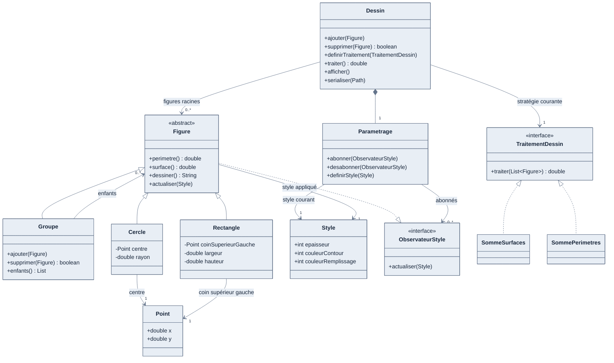

# Atelier de dessin

Examen blanc de design patterns et de programmation orientée aspect · ENSET Mohammedia

[1. Conception](#1--diagramme-de-classes-et-justification) · [2. Implémentation](#2--implémentation-maven) · [3. Tests du modèle](#3--tests-du-modèle) · [4. Aspects](#4--journalisation-et-sécurité) · [5. Tests avec AspectJ](#5--tests-avec-aspectj) · [6. Interface graphique](#6--interface-graphique)

## 1 · Diagramme de classes et justification



| Pattern | Rôles dans le modèle | Justification |
| --- | --- | --- |
| **Composite** | `Figure` est le composant. `Cercle` et `Rectangle` sont les feuilles. `Groupe` est le composite. | Un dessin appelle les mêmes opérations sur une figure simple et sur un groupe. Le groupe propage l’affichage et agrège les mesures de ses enfants récursivement. |
| **Observer** | `Parametrage` publie un `Style`. `Figure` implémente `ObservateurStyle`. | Le dessin abonne ses figures racines. Lors d’un changement, chaque groupe relaie le nouveau style à ses descendants. Une figure ajoutée reçoit immédiatement le style courant. |
| **Strategy** | `Dessin` est le contexte. `TraitementDessin` définit le contrat. `SommeSurfaces` et `SommePerimetres` sont les stratégies. | `definirTraitement` change l’algorithme en cours d’exécution. Ajouter un traitement revient à implémenter le contrat de stratégie. |

## 2 · Implémentation Maven

Le [modèle Java](src/main/java/net/zoungrana/dessin) compile avec le JDK 21. La première implémentation métier est isolée dans le commit `27f595c`.

| Figure | Surface | Périmètre |
| --- | --- | --- |
| Cercle de rayon R | π × R² | 2 × π × R |
| Rectangle de largeur L et de hauteur H | L × H | 2 × (L + H) |
| Groupe | Somme des surfaces de ses enfants | Somme des périmètres de ses enfants |

Les mesures du groupe correspondent à une somme, y compris lorsque des figures se superposent. Les dimensions doivent être finies et strictement positives. Un groupe refuse les ajouts qui créeraient un cycle. Les couleurs sont des entiers RGB, par exemple `0x263548`.

`Dessin.afficher()` imprime l’état des figures, avec retrait pour les groupes imbriqués. `Dessin.serialiser(Path)` écrit le graphe dans un fichier binaire Java. Le fichier conserve les figures, le paramétrage, les abonnements et la stratégie active.

## 3 · Tests du modèle

```powershell
mvn test-compile surefire:test@default-test
```

Les quatre [tests du modèle](src/test/java/net/zoungrana/model/DessinTest.java) s’exécutent sans agent AspectJ. Ils vérifient les formules et les dimensions invalides, la récursion et le changement de stratégie, la propagation du style et le désabonnement, puis la relecture du fichier binaire avec les abonnements rétablis.

## 4 · Journalisation et sécurité

AspectJ tisse les classes au chargement. [La configuration](src/main/resources/META-INF/aop.xml) déclare les classes à tisser et les deux aspects. Le code de journalisation et de contrôle d’accès est dans le [package technique](src/main/java/net/zoungrana/technique). Les annotations `@ExigeRole` indiquent les règles sur les méthodes concernées.

- **Journalisation.** Un conseil `@Around` écrit la signature à l’entrée et à la sortie. Il mesure la durée avec `System.nanoTime()` et journalise la sortie depuis un bloc `finally`. Les appels refusés apparaissent donc aussi dans le journal. Les arguments et les valeurs retournées sont exclus des traces.
- **Sécurité.** La connexion vérifie l’identifiant et le mot de passe et enregistre les rôles dans la session du thread. Un conseil `@Before` vérifie le rôle avant chaque opération annotée. Une session absente ou un rôle insuffisant déclenche une `SecurityException`.

| Droit requis | Opérations sur le dessin |
| --- | --- |
| `LECTURE` | `afficher`, `traiter`, `figures` |
| `EDITION` | `ajouter`, `supprimer`, `definirTraitement`, `parametrage`, `serialiser` |

La modification d’une figure, d’un groupe ou du paramétrage exige aussi `EDITION`. Les deux comptes locaux servent à la démonstration.

| Identifiant | Mot de passe de démonstration | Rôles |
| --- | --- | --- |
| `lecteur` | `demo-lecture` | `LECTURE` |
| `editeur` | `demo-edition` | `LECTURE`, `EDITION` |

## 5 · Tests avec AspectJ

```powershell
mvn clean package
```

Surefire exécute d’abord les **4 tests du modèle**, puis les **3 tests AspectJ** avec `-javaagent`. La [suite AspectJ](src/test/java/net/zoungrana/aspects/DessinAopTest.java) couvre les accès sans session, l’échec d’authentification, les droits des deux comptes, la création effective du fichier et la journalisation des appels autorisés et refusés.

### Démonstration en console

Depuis la racine du projet, après la compilation, exécuter dans PowerShell les commandes ci-dessous. Le chemin utilise le dépôt Maven local par défaut.

```powershell
$agent = Join-Path $env:USERPROFILE '.m2/repository/org/aspectj/aspectjweaver/1.9.22.1/aspectjweaver-1.9.22.1.jar'
$app = 'target/examen-blanc-1.0-SNAPSHOT.jar'
java "-javaagent:$agent" '-Djava.util.logging.SimpleFormatter.format=%5$s%n' -cp "$app;$agent" net.zoungrana.Main
```

Avec `lecteur`, le dessin et sa surface totale s’affichent, puis l’enregistrement est refusé. Avec `editeur`, les mêmes opérations aboutissent et le fichier `target/dessin.bin` est écrit.

Extrait d’une exécution avec le compte `lecteur`.

```text
Surface totale : 12440.84
Entrée  Dessin.serialiser(..)
Sortie  Dessin.serialiser(..) (1.164 ms)
Accès refusé. Rôle requis : EDITION
```

**Capture à ajouter.** Se connecter en tant que `lecteur` et capturer les lignes d’entrée et de sortie de `Dessin.serialiser`, sa durée et le message de refus. Fichier souhaité → `docs/captures/console-lecteur.png`.

## 6 · Interface graphique

Le [mode graphique Swing](src/main/java/net/zoungrana/interfacegraphique/FenetreDessin.java) utilise Java2D, fourni avec le JDK. Il affiche les figures imbriquées sur une toile et réutilise le modèle et les aspects du mode console. L’éditeur peut passer de la somme des surfaces à celle des périmètres, appliquer un autre style et enregistrer le dessin. Le rôle lecteur donne accès à l’aperçu et à la surface totale.

```powershell
java "-javaagent:$agent" '-Djava.util.logging.SimpleFormatter.format=%5$s%n' -cp "$app;$agent" net.zoungrana.Main --graphique
```

**Capture à ajouter.** Se connecter en tant qu’`editeur`, puis activer **Périmètre** et **Changer le style**. Capturer la fenêtre entière avec les figures et le périmètre affiché. Fichier souhaité → `docs/captures/atelier-editeur.png`.
